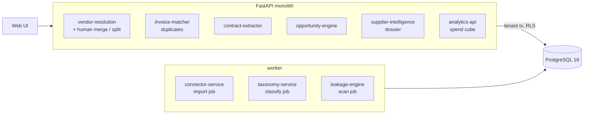

# Enterprise Procurement & Spend Intelligence Platform

Finds money leaking out of accounts payable: merges the many spellings of each supplier into one vendor, classifies spend,
catches invoices paid twice, reads contracts for their rate cards and rebate clauses, checks every invoice line against them,
and ranks what to recover or renegotiate, with the evidence for each finding.

Built from blueprint 7 of an "Enterprise SaaS + AI" build book as a **vertical slice**: the demo scenario end to end, with the
platform parts real and the rest listed under [Not built](#not-built-and-why).

**Every vendor, invoice and contract is synthetic, and the leakage was planted. Real ledgers are messier than this one.**

## Run it

```bash
docker compose up --build        # migrates, trains two small models, serves http://localhost:8107/ui/
docker compose run --rm test     # 21 tests against a throwaway database
```

Open http://localhost:8107/ui/ and press **Run all steps**, or `make bootstrap demo`. API docs at `/docs`.
Demo tokens (local only): `acme-procurement-demo`, `acme-analyst-demo`, `acme-admin-demo`.

## The demo, step by step

1. Import one year from three source systems: $550M of spend, 41,021 invoices, 116,197 lines, 985 vendor records, 129 contracts. A quarter of the lines have no category.
2. Entity resolution folds 985 vendor records into 413 companies. "Wren Cloud Services Ltd", "Wren Cloud Services Limited" and "WREN CLOUD SVCS LTD." (twice, in two systems) become one vendor.
3. A classifier files the 29,150 uncategorized lines ($139M) into the taxonomy at 98.9% mean confidence; 202 low-confidence lines are flagged.
4. 195 invoices were paid twice ($3.03M); 85 of them were entered under another spelling of the vendor. A same-record, same-number check finds 50. A consulting contract is read for its rate card, each rate with its clause.
5. Leakage for the year: $6.23M (1.1% of spend): $3.03M paid twice, $1.80M billed above contract rates across 60 vendors, $1.40M of volume rebates earned and never credited.
6. Six vendors sell overlapping collaboration software; moving the four smallest onto the two largest is ranked beside the money simply owed back.
7. A negotiation dossier for the consulting firm (spend, rate card against what was billed, findings, alternatives, days to contract end) and a $6.31M pipeline across 96 opportunities.

## Architecture



| Piece | How it works |
|---|---|
| Vendor resolution | Names are normalised (legal endings stripped, abbreviations expanded); records sharing a name token, tax id or bank account are compared; a logistic regression scores name-token overlap, character-trigram overlap and agreement or conflict of tax id, bank and address; pairs above 0.5 are clustered. Human merge / split decisions override the model and are remembered. |
| Classification | Character n-gram TF-IDF + logistic regression over a two-level taxonomy; predictions carry a confidence. |
| Duplicates | Same resolved vendor, same total, dates within 14 days, and invoice numbers that reduce to the same digits (`INV-00123`, `123`, `00123-A`, `INV-OO123`). |
| Contract terms | Regular expressions per clause; every term is stored with its section and the sentence it was read from. No language model. |
| Leakage | Hours billed above the contracted rate for the role; rebates owed once annual spend passes the threshold, minus credits received; duplicate payments. Each finding links to an invoice line and a contract term. |
| Opportunities | Score = savings x confidence x renewal timing / effort. Consolidation uses a stated 12% saving on moved spend. |
| Platform | Row-level security per tenant, Postgres job queue, idempotent imports, hash-chained audit log, `/metrics`. |

## Data model

`migrations/002_spend.sql` follows the blueprint (vendors, vendor_aliases, spend_categories, purchase_orders, invoices,
invoice_lines, contracts, contract_terms, leakage_findings, opportunities); additions are marked `(+)`.

## API

| Method | Endpoint | Purpose |
|---|---|---|
| POST | `/v1/imports` | 202 + job: ERP / AP / card import |
| POST | `/v1/vendors:resolve` | Supplier entity resolution, with optional human decisions |
| GET | `/v1/spend/cube` | Spend by any two whitelisted dimensions |
| GET | `/v1/invoices/duplicates` | Probable duplicate pairs with evidence |
| POST | `/v1/contracts/{id}:extract` | Rate cards and commercial terms with citations |
| GET | `/v1/leakage` | Contract-versus-invoice findings and the annual total |
| GET | `/v1/opportunities` | Ranked savings opportunities |
| GET | `/v1/vendors/{id}/dossier` | Negotiation dossier |
| POST | `/v1/spend:classify` · `/v1/leakage:scan` | (+) Jobs: classify uncategorized lines · read every contract and scan |

Contract: [`docs/openapi.json`](docs/openapi.json).

## Measured

[`docs/evaluation.md`](docs/evaluation.md) (`python -m sp.evaluate`) and [`docs/performance.md`](docs/performance.md).

| Component | Result | Baseline |
|---|---|---|
| Vendor resolution (pairwise, unseen world) | precision 1.0, recall 0.9975 | identical normalised name: recall 0.826 |
| Spend classification, 21 categories | 99.0% | keyword rules: 72.5% |
| Planted duplicate invoices, three years | 571 of 571, none false | same record + same number: 156 of 571 |
| Contract rate cards read exactly | 129 of 129 | |
| Demo totals against the planted truth | overbilling within 1%, rebates within 5%, duplicates within 3 pairs | |

These are high because the synthetic data is regular: descriptions come from a phrase bank, contracts from three phrasings per clause.
The comparison with each baseline is the meaningful part. The end-to-end test recomputes the planted leakage independently and
checks the demo's totals against it.

## The hardest tradeoff

Order of operations. Almost everything depends on vendor resolution: 85 of the 195 duplicate payments in the demo year were entered
under a different spelling of the vendor, so a duplicate check run before resolution cannot see them, and contracts attach to a
vendor, so leakage cannot be scanned before it either. That makes resolution a single point of failure: a wrong merge would create
false duplicates and attach the wrong rate card. So the resolver is tuned for precision first (conflicting tax ids count against a
merge; uncertain pairs are listed for a person), merges are reversible by a recorded human decision, and vendor ids are derived from
their member records so a re-run does not shuffle them. The cost is that everything downstream must be recomputed when resolution
changes; here that is cheap, at scale it would need incremental updates.

## Threat model (summary)

| Threat | Mitigation here | Gap |
|---|---|---|
| One company's ledger visible to another | Row-level security on vendors, aliases, invoices, purchase orders, contracts, findings and opportunities; tested by importing a second tenant | Invoice lines rely on the join to their invoice |
| Injection through analytics parameters | Cube dimensions are looked up in a fixed map; anything else is a 422 (tested with SQL in the parameter) | |
| Exposing bank and tax details | Stored as salted hashes; matching only needs equality | One global salt from code |
| A wrong merge silently distorting findings | Pair confidence stored per record, uncertain pairs surfaced, human decisions recorded with who and when | No approval workflow before a merge takes effect |
| Disputed findings | Each finding carries its contract clause and sentence; imports, resolutions, extractions and scans are audited in a hash chain | No external anchor |

## Not built, and why

- **Real ERP / AP / card connectors**: one deterministic synthetic extract stands in.
- **A language model for contract terms**: regular expressions match the synthetic phrasings; the cited-clause output shape is what would carry over.
- **Subsidiary and parent roll-up, currencies other than USD, tax handling**: not modelled.
- **Receipts (three-way match), payment-term and early-payment leakage, maverick-spend detection**: not started.
- **Millions of lines, incremental recomputation after a merge**: see performance.md.
- **Kafka, Redis, OpenTelemetry, Grafana, Terraform, CI, SSO, a Next.js front end**: not needed to prove the slice; no cloud account used.

## Commercial sketch

Buyer: procurement teams and CFO organisations. Pricing shape from the blueprint: annual subscription by spend volume and
connectors, a gain-share option on verified savings, contract intelligence as a premium module. The UI's "What is it worth?" panel
applies an assumed recovery rate to the findings and compares it with an assumed subscription cost.

## Layout

```
core/        platform kit: db + RLS, jobs, audit chain, HTTP, scenario runner, load test
sp/          world (synthetic ledger), engine (resolution, classifier, duplicates, contract terms, leakage, scoring), api, seed, evaluate, make_scenario
migrations/  forward-only SQL          web/   UI, scenario.json, demo.json (recorded run)
tests/       21 tests                  docs/  evaluation.md, performance.md, openapi.json
```
